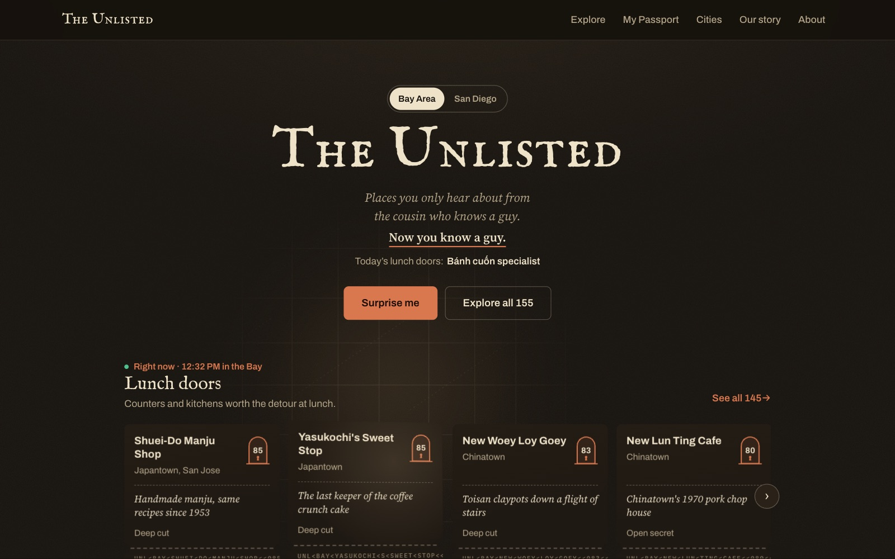
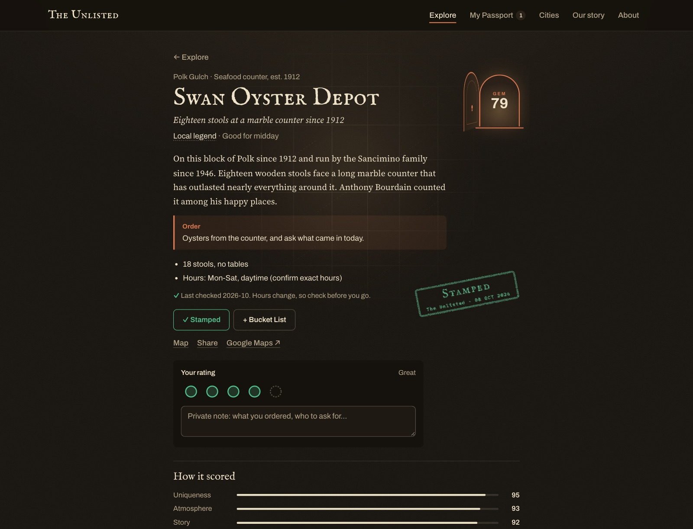
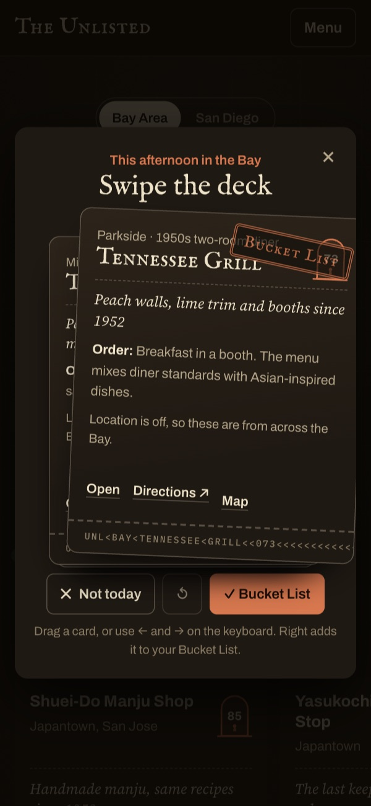
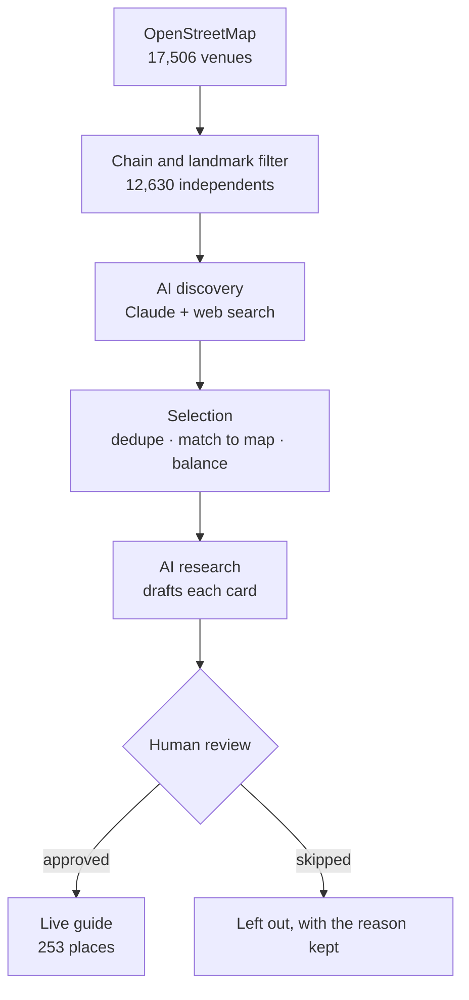
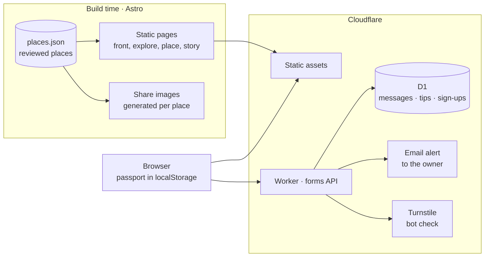

<picture>
  <source media="(prefers-color-scheme: dark)" srcset="docs/assets/banner-dark.svg">
  
</picture>

<p align="center">
  <a href="https://unlisted.icarianforge.com"></a>
  <a href="https://github.com/lautbzehn/the-unlisted/actions/workflows/ci.yml"></a>
  
  
  
  
  <a href="LICENSE"></a>
</p>

<p align="center">
  <a href="https://unlisted.icarianforge.com"><b>Open the guide</b></a> ·
  <a href="docs/data-pipeline_v1.0_10.11.2026.md">How places are found</a> ·
  <a href="docs/architecture_v1.2_10.17.2026.md">Architecture</a> ·
  <a href="docs/adr">Decision records</a> ·
  <a href="CHANGELOG.md">Changelog</a>
</p>

---

## In one minute

**The problem.** Review apps reward the places that are already famous. The hole-in-the-wall spots locals actually love get buried under chains, ads, and star inflation.

**What it is.** A hand-picked guide to independent food and drink in the **Bay Area** and **San Diego**: 253 places, each with a one-line tagline, a story, a signature order, and a **Hidden Gem Score**. You collect stamps in a passport, let **Surprise me** deal you a place, or browse by neighborhood and time of day.

**How it was made.** AI did the heavy lifting and a person made every call. A pipeline screened **17,506 venues** from open map data, filtered out chains, and had Claude (with web search) discover and research candidates. Every published place was reviewed by hand. Total AI research cost: **about $70**.

> Built by **[Dan West](https://www.icarianforge.com)**, an AI strategy and adoption leader with nearly 20 years in IT, by directing Claude Code as the engineering team.

<p>
  
</p>
<p>
  
  
</p>

## Highlights

| | For a visitor | Under the hood |
|---|---|---|
| **Only independents** | No chains, no ads, no paid placement. | OpenStreetMap data with a chain and landmark filter: 17,506 venues down to 12,630 independents. |
| **An honest score** | Five marks you can see, not a mystery star rating. | Uniqueness 25%, Atmosphere 20%, Story 20%, Signature item 15%, Under the radar 20%, computed from one shared formula and never typed in. |
| **"Deep cut" means it** | Famous places can't pass as secrets. | A place covered by two or more press outlets is relabeled an "open secret." |
| **Right now** | Finds what fits the time of day you're in. | Time-of-day labels per place, by Bay Area or San Diego local time. |
| **Your passport** | Stamps, notes, and ratings that are yours. | Stored only on your device. No account needed. |
| **AI as a researcher, not an author of record** | Every word was checked by a person before it went live. | Claude drafts cards from web research; drafts stay hidden until reviewed. |

## How a place gets in



Each step is a script in [`scripts/pipeline/`](scripts/pipeline), budget-capped, with a free `--estimate` mode before anything is spent. The research briefs and rubric live in [`prompts/`](prompts). Full detail: **[How places are found](docs/data-pipeline_v1.0_10.11.2026.md)**.

## Engineering

<details open>
<summary><b>Architecture at a glance</b></summary>



Pages are pre-rendered, so the guide is fast and cheap to run. The only server code handles the contact, suggestion, and sign-up forms. Detail: **[docs/architecture](docs/architecture_v1.2_10.17.2026.md)**.
</details>

<details>
<summary><b>Quality and security</b></summary>

- **CI:** every pull request and push to `main` installs from the lockfile, runs the API tests, and runs a full production build.
- **Tests:** 39 unit tests for the forms API: input validation, the request guards, and the SQL itself, run against the real migrations in an in-memory SQLite. They use Node's built-in test runner, with no test dependencies.
- **Forms:** every submission must come from the site itself, be JSON under 16 KB, and pass a Cloudflare Turnstile check issued for this hostname. Inputs are validated and length-limited before any query, queries use bound parameters, visitors are identified only by a keyed anonymous hash, and each form has two daily limits: one per visitor and one for the whole site, so a flood from many addresses still stops at a known number.
- **Privacy:** no accounts, no tracking. Your passport stays on your device. The owner's notification address is a Cloudflare secret, never in the code.
- **Browser hardening:** a strict content security policy (only the site's own scripts, the few small ones Astro inlines allowed by hash, Turnstile, and the map tiles), HSTS, `nosniff`, cross-origin window isolation, same-origin framing, a strict referrer policy, and camera, microphone, and payment access disabled. Location is allowed for this site only, for the "near me" sort.
- See [SECURITY.md](SECURITY.md).
</details>

<details>
<summary><b>Run it locally</b></summary>

```bash
npm ci
npm run dev        # http://localhost:4321
npm run build      # static build plus share images
```

The research pipeline needs an Anthropic key in `.env` and always offers a free `--estimate` first:

```bash
node --env-file=.env scripts/pipeline/05-enrich.mjs --estimate
```
</details>

<details>
<summary><b>Repository layout</b></summary>

```
src/pages/              Routes: front page, explore, place pages, passport, story, how the score works, forms
src/components/         The passport, ticket cards, map sheet, Surprise me deck, Gem door, header and footer
src/lib/                Scoring formula, place helpers, map style, config
src/data/places.json    The reviewed places that ship
worker/                 Cloudflare Worker: router (index), guards (http, security), validation, D1 store, notifications, tests
migrations/             D1 schema
scripts/pipeline/       The research pipeline, steps 01 to 07
prompts/                Research briefs and the enrichment rubric
data/                   Pipeline inputs, drafts, and review sheets
docs/                   Architecture, data pipeline, decision records, screenshots
```
</details>

## How it was built

I designed the product, set the editorial rules (independents only, honest scores, every place reviewed by a person), and directed **Claude Code** as the engineering team. Claude wrote most of the code and drafted the place research; I reviewed and approved what went live. The working agreement is in [`AGENTS.md`](AGENTS.md); the reasoning behind the bigger choices is in the [decision records](docs/adr).

**Stack:** Astro 7 · MapLibre GL with OpenFreeMap tiles · Cloudflare Workers, D1, Turnstile, and Email · Anthropic API with web search and Message Batches.

## About

<a href="https://www.icarianforge.com"><b>Icarian Forge</b></a> is my personal AI lab, where I build and test what I advise on. The code is © 2026 Dan West, all rights reserved; see [LICENSE](LICENSE). Map data © OpenStreetMap contributors, see [NOTICE](NOTICE).

**Get in touch:** [LinkedIn](https://www.linkedin.com/in/dan-w-21b8a561/) · hello@icarianforge.com
