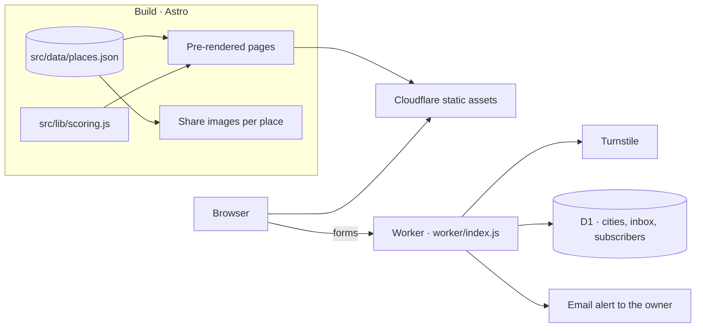

# Architecture

**v1.0 · 10.11.2026** · The Unlisted 1.3

## Goals

| Goal | Consequence |
|---|---|
| Fast and nearly free to run | Every page is pre-rendered at build time; only the forms run server code. |
| No accounts, real privacy | The passport lives in the visitor's browser. Forms store only what the visitor typed. |
| A guide people trust | Data and scores come from one reviewed source of truth and one shared formula. |

## System overview

## Front end

- **Astro 7** renders the front page, Explore, place pages, the passport, Our Story, Help, and "How the score works" as static HTML, with small scripts for interaction.
- **Map:** MapLibre GL with OpenFreeMap tiles and a custom vintage style, lazy-loaded.
- **Passport, notes, and ratings:** `localStorage`, on the visitor's device only.
- **Share images:** generated per place at build time.

## Server

One Cloudflare Worker handles `/api/*`:

- **Forms:** contact, suggest a place, sign up, and city votes and suggestions.
- **Protection:** a Turnstile check on every submission, an anonymous keyed visitor hash, and daily caps per visitor and form.
- **Storage:** D1, with schema in [`migrations/`](../migrations).
- **Alerts:** an email to the owner through Cloudflare's email binding, addressed by the `NOTIFY_TO` secret.

## Data

Places come from the [research pipeline](data-pipeline_v1.0_10.11.2026.md). Only approved places are written to `src/data/places.json`, which is the single source the build reads.

## Delivery

- **CI** builds every pull request and push to `main`.
- **Release:** `npm run deploy` (build, then `wrangler deploy`) from the owner's release session.
- **Hardening:** security headers from `public/_headers`, including a content security policy whose inline-script hashes are filled in by `scripts/csp.mjs` after each build.
