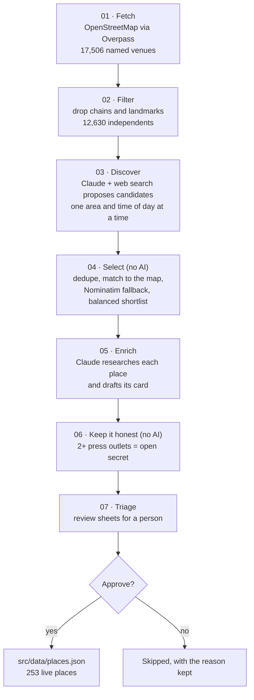

# How places are found

**v1.0 · 10.11.2026** · The Unlisted

The guide is built by a seven-step pipeline in [`scripts/pipeline/`](../scripts/pipeline). AI does the reading; a person makes every call. Every paid step has a free `--estimate` mode that shows the plan and the worst-case cost before anything is spent.

| Step | Script | AI? | What it does |
|---|---|---|---|
| 1 | `01-fetch-osm.mjs` | No | Downloads every named restaurant, bar, cafe, bakery, deli, ice cream shop, and similar venue in the target area from OpenStreetMap. |
| 2 | `02-filter-chains.mjs` | No | Removes chains and famous landmarks, keeps independents, and labels each with an approximate area. |
| 3 | `03-discover.mjs` | Yes | Asks Claude, with web search, to propose candidates one area and time of day at a time, through the Batch API. |
| 4 | `04-select.mjs` | No | Dedupes, drops places already in the guide, matches each to OpenStreetMap for exact coordinates, and picks a balanced shortlist. |
| 5 | `05-enrich.mjs` | Yes | Claude researches each selected place with web search and fetch, and drafts its card by the rubric in [`prompts/enrich-place.md`](../prompts/enrich-place.md). |
| 6 | `06-fix-fame.mjs` | No | Keeps the "deep cut" label honest: a place covered by two or more press outlets becomes an "open secret." |
| 7 | `07-triage.mjs` | No | Builds review sheets so a person can approve, edit, or skip each draft. |

## The Hidden Gem Score

Five marks, each 0 to 100, combined by one shared formula in [`src/lib/scoring.js`](../src/lib/scoring.js):

| Mark | Weight |
|---|---|
| Uniqueness | 25% |
| Atmosphere | 20% |
| Story | 20% |
| Signature item | 15% |
| Under the radar | 20% |

Scores are always computed, never typed in, and the [How the score works](https://unlisted.icarianforge.com/how-the-score-works/) page lets anyone try the formula.

## Cost and control

- Research for both cities cost about **$70** in total (Bay Area about $52, San Diego about $18).
- Batches run in small groups so a person can review before spending more.
- Drafts are visible only in local development until approved.

## Data sources

Venue data © OpenStreetMap contributors (ODbL). See [NOTICE](../NOTICE).
